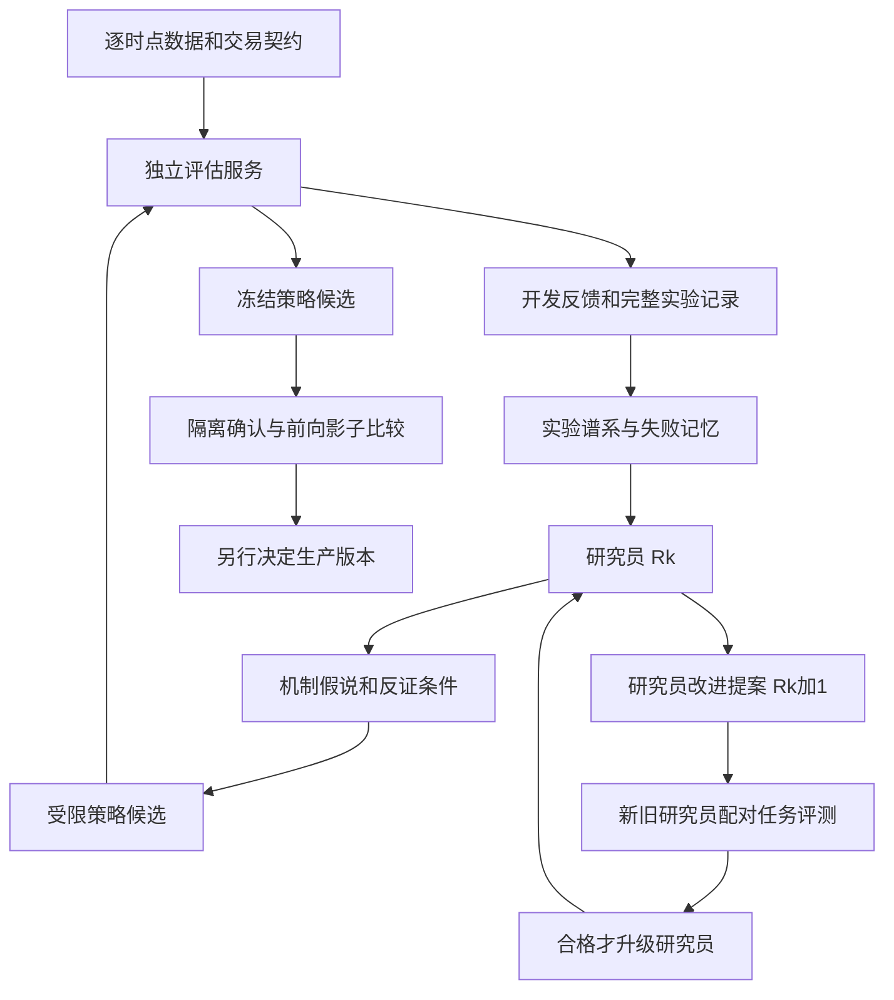

# AI 自进化研究与 ETF 动量策略实施方案

研究截止日期为 2026 年 11 月 9 日。这里的 RSI 指 Recursive Self Improvement，即递归自我改进，不指技术指标相对强弱指数。对象是本仓库当前主推送 V12-R2，固定候选 `v12r2_08b522c2e1aa291f054d`。

**结论：值得做，但应该建设能够改进研究方法的系统，并把策略盈利能力单独验证。** 现有 AI 研究已支持有限的代码、提示、记忆和研究流程自改进；对你的项目，最有价值的路线是“可信评估器 → 有记忆的策略研究 → 研究员自身进化 → 独立前向验证”。直接要求 AI 无限提高 2014—2026 历史年化，极可能把更多算力变成更多历史选择偏差。

你的项目已经有候选登记、冻结快照、完整收益矩阵、独立参考引擎、多重比较诊断和前向账户。真正的缺口集中在可执行的盘中时钟、逐时点可投资资产全集、跨代研究记忆和研究员自身的独立评测。无需从零重写回测系统，也无需先训练基础大模型。

本次新增的是研究报告与只读证据复核脚本。没有搜索新策略、修改主推送、重置账户或发出交易指令。以下方案是基于论文和仓库证据提出的设计，不代表这些改变已经提高收益。

## 1 自进化应该发生在哪一层

| 层次 | 动量项目中的例子 | 能否称为研究 RSI |
|---|---|---|
| 市场适应 | 波动变大时减仓，趋势改变时换 ETF | 属于策略行为；规则不变时不是研究器进化 |
| 参数搜索 | 自动遍历 WLS 窗口、缓冲、止损倍数 | 属于搜索，搜索方法本身没有进化 |
| 策略程序演化 | AI 提出新排名公式或新的风险退出模块 | 属于自动研究；仍需考察研究方法是否改变 |
| 研究员演化 | 改善假说生成、实验分配、失败诊断、记忆检索，并在新任务上更可靠 | 本项目最值得追求的有限 RSI |
| 模型权重自改进 | 用研究轨迹训练新的基础或专用模型 | 成本和证据需求更高；权重更新本身也不自动构成 RSI |

可以把两层状态写为：策略候选 `P`，研究员 `R`，可信评估器 `E`。内层由 `R` 根据证据生成并筛选 `P`；外层比较 `R` 与修改后的 `R'`，判断谁能在相同预算、新任务上产生更好的研究结果。`E` 在一个实验周期内冻结。

如果外层改进程序始终固定，只优化下层研究员，更严格的说法是研究过程元优化。让改进后的研究机制实际参与后续改进，才形成更强的递归闭环；闭环成立也不代表改进会加速。实施时先验证有限元优化有效，再比较新研究员是否更善于推动下一代改进。

**策略分数升高、研究员能力提高、实盘盈利增强，是三个需要分别证明的命题。** 2026 年综述也区分了有限自我修正与开放式递归改进，强调反馈信号的可靠性。[RSI 综述](https://arxiv.org/abs/2607.07663)

## 2 论文和工程实践给出的证据

以下优先采用论文正文、作者项目及官方技术文章。预印本结果按作者报告理解，没有把方法名称当作有效性的证明。

| 工作 | 实际机制 | 对本项目的用途和限制 |
|---|---|---|
| [STOP，2023／COLM 2024](https://arxiv.org/abs/2310.02304) | 改进程序调用固定 LLM，并修改改进程序自身 | 提供研究器可被优化的早期范式；不是基础模型自己升级 |
| [Gödel Agent，ACL 2025](https://arxiv.org/html/2410.04444v4) | 读取和改写自己的逻辑，接受环境反馈 | 可借鉴模块化自修改；不继承理论 Gödel Machine 的全局最优保证 |
| [SICA，2025](https://arxiv.org/html/2504.15228v1) | 从档案选 agent 改进自身，以任务成功和资源成本评价 | 研究员版本必须经过实际任务检验，不能靠自述晋级 |
| [Darwin Gödel Machine，2025](https://arxiv.org/html/2505.22954v3) | 保留多个 agent 分支，由旧分支产生新版本 | 借鉴多样性和祖先档案；论文任务是编程，不能直接推导交易超额 |
| [AlphaEvolve，2025](https://arxiv.org/html/2506.13131v1) | 生成程序、自动评估、群体选择、分级评测 | 适合作为策略搜索内环；主要是外部算法优化，并非所有组件递归改变 |
| [GEPA，2025](https://arxiv.org/html/2507.19457v1) | 从执行轨迹提炼文字反馈，演化提示并保留互补候选 | 适合先改进研究提示和诊断流程，易审计 |
| [ACE，2025](https://arxiv.org/html/2510.04618v1) | 增量整理和维护经验上下文 | 适合失败记忆；其金融任务是文档识别与问答，不是交易收益实验 |
| [AIDE²，2026 年 9 月](https://arxiv.org/html/2609.26457v1) | 自动改进研究 agent 的搜索、记忆与运行框架 | 最接近研究员进化；有外部任务迁移，但递归加速证据仍不足 |
| [AQuA，2026 年 8 月](https://arxiv.org/html/2608.12841v1) | 在冻结数据和评估器内，用受限表达式或配置开展量化研究，并积累经验 | 最贴近本项目；无实盘验证，测试隔离仍依赖协议执行 |
| [RD-Agent-Quant，2025](https://arxiv.org/html/2505.15155v1) | 假说、编码、评估、分析闭环，分配因子与模型研究预算 | 借鉴编排和经验库；原实验市场和时段不是你的 ETF 轮动 |
| [QuantAgent，2024](https://arxiv.org/abs/2402.03755) | 内循环改候选，外循环用实验更新知识库 | 适合搭建实验记忆；理论效率不等于盈利保证 |
| [AlphaAgent，2025](https://arxiv.org/html/2502.16789v1) | 经济假设、表达式结构、相似性和复杂度控制 | 可减少同义公式、重复策略和复杂度膨胀 |
| [AlphaGen，KDD 2023](https://arxiv.org/abs/2306.12964) | 评价新因子对已有组合的贡献 | 提醒研究增量价值；不是研究员递归改进 |
| [AlphaForge，AAAI 2025](https://arxiv.org/html/2406.18394v5) | 分离因子生成和动态组合 | 组合规则也要作为独立候选接受检验 |
| [AlphaPROBE，2026](https://arxiv.org/html/2602.11917v1) | 利用因子祖先关系组织探索 | 可把旧 experiments 和各代候选变成可追溯谱系 |

AIDE² 的主运行在 8 天内接受了 7 次改进，并报告向外部基准迁移。需要注意，主运行的外层改进者仍固定；让发现的 agent 再充当改进者的 ignition test 每组只有 3 个种子，作者明确认为结果不确定。因此它支持有限研究流程改善，尚未证明自我改进越来越快。[AIDE² 第 3.6 节](https://arxiv.org/html/2609.26457v1#S3.SS6)

AQuA 最有价值的教训来自附录 B：一个盘中成交量特征用了全天成交量作分母，另一个审查 agent 也漏掉了前视。作者随后限制为因果算子和配置接口。其适用边界是有限市场、频率和模拟成本；论文没有实盘验证。[AQuA 正文及附录](https://arxiv.org/html/2608.12841v1)

网上可用工具的定位也应分清：

| 工具或实践 | 可以借用什么 | 不应误解成什么 |
|---|---|---|
| [Karpathy autoresearch](https://github.com/karpathy/autoresearch) | 固定评估和实验预算，只开放一个明确修改面 | 原项目人写研究规范，不等于自动研究器自改进已经完成 |
| [OpenEvolve](https://github.com/algorithmicsuperintelligence/openevolve) | 程序群体、岛屿搜索、候选档案和自动评估编排 | 第三方开源实现，不是 Google 官方产品，也不是金融回测器 |
| [GEPA 作者仓库](https://github.com/gepa-ai/gepa) | 提示、程序文本与反馈驱动的搜索 | 必须自己定义可靠的金融任务和评价方式 |
| [Microsoft RD-Agent](https://github.com/microsoft/RD-Agent) 与 [Qlib](https://github.com/microsoft/qlib) | 参考研究流程、表达式与数据基础设施 | 没必要为了使用框架而替换已验证的定制执行状态机 |
| [Google 2026 年 11 月 5 日实践](https://cloud.google.com/blog/topics/developers-practitioners/how-to-build-an-agent-skill-optimizer-with-alphaevolve-and-harbor) | 候选与基线配对运行，再用未参与搜索的任务比较 | 技能优化实验并不总有收益 |
| [Google 2026 年 11 月 3 日实践](https://cloud.google.com/blog/topics/developers-practitioners/evaluate-agent-skills-before-they-bloat-your-context-window) | 将答案和验证器隔离，防止读取答案得高分 | “只在提示词里禁止作弊”不是权限隔离 |

新的反证也值得关注。[Thinking Fast, Trading Late，2026 年 11 月 2 日预印本](https://arxiv.org/abs/2611.03985) 报告事前冻结后，新闻模型在盲测和成本检验中未能保留开发阶段优势。这不能否定价格动量，但提醒我们：理解市场、写出合理解释、得到验证集高分，都不等于可成交收益。该论文很新，仍需独立复现。

## 3 你的策略现状与可复核证据

当前生产身份见 [主 README](../../README.md)、[版本常量](../../v12_live/constants.py) 和 [接入记录](../../integrations/v12_r2_rollout_20260928.md)。它是 11 只 ETF 的单持仓系统：7 只境内股票 ETF、纳指、港股创新药、黄金、货币。

主要逻辑是 WLS25 斜率除以 20 日波动、最近 4 个实际报价分数平滑、沪深300 MA180 市场状态、分池换仓缓冲、至少 2 日健康持仓、前报价波动决定急跌门槛，以及深跌／量能抄底。风险资产需要 270 个自身实际报价；抄底入场锁仓 5 日，锁内急跌退出关闭。它还允许负动量跨境或黄金作为后备，因此不属于任何弱市都回到现金的系统。[实时策略](../../v12_live/policy.py)、[冻结研究协议](../../v12_r2/PROTOCOL.md)

从保存的收益矩阵独立重算，结果如下。区间为 2014-01-02—2026-09-24，共 3097 个交易观察；244 日年化、修正总回报、首评价日免费。最大回撤以下用损失幅度表示。

| 撮合和费用假设 | 年化收益 | 最大回撤 | 换仓次数 |
|---|---:|---:|---:|
| 理想同收盘，单边 1bp | 55.2694% | 20.5553% | 310 |
| 理想同收盘，单边 11bp | 47.8585% | 21.9742% | 310 |
| 延迟一个收盘，单边 1bp | 39.7184% | 28.3042% | 312 |
| 延迟一个收盘，单边 11bp | 33.0078% | 30.9807% | 312 |

增加成本后的年化变化为约 7.41 个百分点；单边 1bp 下增加一个收盘延迟，变化约 15.55 个百分点。这说明执行假设是重要研究变量，不能说明实际收益必然等于某个压力场景。**次收盘、次开盘、当日 14:50 是三个不同实验。** 现有冻结数据不能冒用占位 open 字段生成真实次开盘回测。[计算结果](evidence.json)、[复核脚本](verify_evidence.py)

R2 登记 864 个原始格点，包含控制后共 866 条唯一记录，其中 862 条可选；严格与折衷资格均为空。当前候选被用户另行指定为主推送，这不改变原研究结论。[R2 报告](../../v12_r2/REPORT.md)、[选择结果](../../v12_r2/results/selection.json)

此前已做 V10 Deep 9558 个唯一单持仓配置、V11 合并族 714 个、V12 合并族 1807 个等研究。它们存在重复和跨代依赖，不能直接相加当独立试验数。现有研究还做过完整候选族的 White-style 区块检验与时序前缀重选，故下一步不能仅把“网格更多、加 walk-forward”包装成全新突破。[V10](../../v10_deep/REPORT.md)、[V11](../../v11/REPORT.md)、[V12](../../v12/REPORT.md)

R2 四情景的 White-style 检验 p 值约 0.958—0.997，未给出这一候选族相对 C4 的显著增益证据。它不是“策略有 99% 概率过拟合”，也没有覆盖所有前代研究。既往 2021 和 2026 都参与选型，重新切分它们不能恢复原生未见样本。[统计限制原文](../../v12_r2/results/statistics/close_1bp_20.json)

工程正确性与投资证据要分开：现有实时策略 7 项测试全部通过，包含未来值扰动不改变 as-of 快照，以及 3097 日分数、风险特征、目标和收益与冻结路径逐值一致。**本次没有发现足以断言当前生产特征有未来函数的证据。** 但这不证明盘中成交结果等同于收盘回测，也不证明未来收益泛化。[测试](../../tests/test_v12_live_policy.py)

## 4 最值得先补齐的证据

**第一是 14:50 的真实信息集合和可执行价格。** 当前实时信号使用新鲜盘中报价，而研究回测使用收盘信息。特别是量能通道，14:50 累计成交量与全天成交量不是同一输入。需保存报价发生时间、接收时间、信号计算完成时间、发送时间、可执行价格、实际或模拟成交延迟。若只用末价虚拟成交，必须标明缺少盘口和真实成交验证。

对纳指等跨境 ETF，境内 ETF 价格、海外底层市场、汇率及净值估计并非同步。应依据每个字段实际发布和可得时间决定能否进入信号，不能把当日标签相同当成同时可知。溢价数据缺失时应按预先规定的缺失处理运行，不能事后使用修订净值填补。

**第二是事前可投资全集。** 仓库控制了上市后有足够报价才入选，但今天选定存活基金和主题后再向历史回看，仍可能带来事后选池偏差。现有数据中，当前 10 只风险 ETF 到 2024-10-31 才全部达到成熟门，所以 2014 起回测并不是完整池共同经历十二年的验证。应补历史基金名单、上市清盘合并、历史流动性、费用和可交易状态；底层指数只能作为独立机制诊断，不冒充 ETF 可成交历史。[已有选池审计](../../reports/research_selection_audit.md)

**第三是新前向证据。** 本地 V12-R2 前向记录截至 2026-11-06，起于 2026-09-29，只有 24 条观察、4 次换仓。它能帮助核查工程行为，远不足以确认长期超额。当前日期之后的数据也只有在候选、选择流程和比较规则事先固定时，才具有相应的前向验证含义。

**第四是研究记忆的准确边界。** 旧动态池研究能支持“当时测试的这些规则失败”，不能支持“所有动态池永远无效”。旧文档的“限制越强损害单调增加”表述也超出了列出的非单调数字。应保留失败结果，将普遍判断降为有适用范围的经验，不能让自动记忆把过强结论固化为真理。[动态池实验](../../v12_pool_test/DYNAMIC_POOL_V2.md)

这四项工作可能降低显示的回测收益，也可能得出暂时不值得继续某条路线。对于 RSI，这属于研究能力改善。

## 5 推荐的系统结构



**冻结内核。** 包括数据可得时点、公司行为、资产资格、成交和记账、成本、年化公式、评价区间、最终确认任务和晋级规则。发现内核错误时允许修正，但必须作为新版本，定位受影响实验、重跑基线、撤销无效成绩；不能让候选自己改评分器后计为收益提升。

**策略修改面。** 第一阶段开放白名单配置或表达式树，只能调用已验证的 trailing 算子、当时可用字段和允许的持仓决策。禁止候选读任意本地文件、网络、完整未来矩阵和保存的测试答案。收益和持仓账本由评估器统一维护，候选只返回目标或权重。

候选还需读取当时真实持仓、入场年龄、锁仓、现金和订单状态；新增策略或研究器内部状态须序列化、版本化并登记。统一执行器在成交或模拟撮合确认后更新状态，不能把交易意图当成已经成交。

**研究员修改面。** 允许改变假说模板、实验优先级、文献与记忆检索、失败摘要、资源分配和停止策略。升级前比较实际任务产出。基础模型版本同时锁定；换模型时另开对照，以免把更强基础模型的收益误称为研究器自进化。

**评估隔离必须落实在进程或环境权限上。** 在同一个可读整个仓库的 shell 中写一句“不要读测试集”，不形成隔离。研究容器只挂开发数据和候选目录；评估服务另持确认数据，返回限定反馈。只返回通过／不通过仍会泄露信息，因此还要限制查询、记录曝光并保留最终未用任务。

现有代码可这样复用：

| 组件 | 可复用基础 | 新增重点 |
|---|---|---|
| 回测与状态机 | `v12/reference.py`、`v12/native.py`、`v12/native.cpp` | 隔离候选接口，继续独立实现对照 |
| 语义身份和去重 | `v12_r2/research.py` | 加表达式结构、行为与机制去重 |
| 输入冻结 | `v12_r2/data.py` | 加首次可得时间、数据修订和资产全集元数据 |
| 完整路径与诊断 | 各代 `paths`、`selection`、`statistics` | 跨代实验检索和无效证据撤销 |
| 实时特征 | `v12_live/policy.py` | 只参考已验证接口，不直接成为自修改目标 |
| 独立影子记录 | `v12_live/ledger.py`、`runtime.py` | 新挑战者独立身份、统一预注册比较规则 |
| 研究器进化 | 当前缺少独立层 | planner、memory、proposer 和隐藏任务 benchmark |

原始份额虚拟账本中的分红再投资和固定成本仍是建模约定，不能当作真实券商成交记录。已有生产事务、推送与账户组件不需要为研究自动化而开放修改权限。

## 6 对动量策略的具体研究方向

以下是待检验的机制假说，不是已经产生收益的建议。研究的单位应是机制家族，每次少量、有解释的改变，随后做消融和反证。

| 优先级与家族 | 要回答的具体问题 | 最小实验与否定条件 |
|---|---|---|
| P0 执行时钟 | 收盘优势有多少能在 14:50 已知信息和可成交价格下保留 | 先建同一天盘中信号回放；分别比较信号变化与成交价格变化。数据不齐时不估造分钟价格 |
| P1 趋势和抄底拆分 | 深跌／放量抄底的增益是否稳定，还是少数事件及锁仓路径主导 | 固定趋势、仅深跌、仅量能、两者合并；保存事件簇和增量净收益。离开少数危机后不稳定则不晋级 |
| P1 平滑与换仓迟滞 | 四报价平滑降低噪声的收益是否超过延迟成本 | 固定经济假说，比较简单多窗口平均、置信度控制的平滑或迟滞；不能为 2021 特设规则 |
| P1 风险资产与现金选择 | 信号弱或排名接近时，强制择一是否增加无效交易 | 与原后备逻辑比较可解释的现金选项；同时比较等风险暴露，不能把减仓降低回撤直接称为 alpha |
| P2 排名尺度校准 | 斜率／波动在不同资产类间是否产生失真排名 | 先诊断按资产类别的分数分布和增量贡献，再测试受限校准；不能事后直接排除亏损基金 |
| P2 小规模持仓组合 | 单一第一名是否使排名误差被放大 | 与少量、简单权重组合比较；按全部成员权重变化计算换手和费用，核算现金、资产簇集中和净收益相关性 |
| P2 时点一致的跨境执行 | 异步市场和可见溢价是否解释部分劣化 | 只用当时已发布信息，评估缺失和延迟；没有可靠历史信息先做前向采样 |
| P3 资产池机制 | 用事前资格重建全集后，结论是否仍成立 | 先完成基金元数据，再研究纳入规则；不再次无约束扩池挑历史冠军 |

第一个可验证的“研究器变聪明”案例可以是：看到扩池后国债等资产获得较多持仓、整体表现下降，它进一步检验跨资产评分是否可比，以及损失来自排名、换仓还是后备路径。持仓天数本身不能证明低波导致评分失真。[扩池原实验](../../v12_pool_test/DYNAMIC_POOL.md) 另一个例子是：看到平滑策略只有少数暴露日改变却造成年度差异，它优先分析决策边界和状态路径，而非继续扩大窗口网格。

多持仓实验需要相匹配的独立份额账本和参考实现；不能直接沿用单持仓换仓时统一扣除两腿固定费率的简化公式。

传统动量文献可以作为机制先验。[Time Series Momentum](https://www.aqr.com/Insights/Research/Journal-Article/Time-Series-Momentum) 研究的是多资产期货等工具的趋势效应，不能直接验证本系统的短窗口 ETF 排名和抄底。经典多空动量的崩溃机制与这里的长仓轮动也不同。文献用于提出可证伪假说，不能替代本策略验证。

## 7 怎样评价策略并避免无限回测选美

**先把目标从“提高 55.27%”改为“在明确执行契约下，是否有足够证据改善当前基线的净收益与风险取舍”。** 55.27% 本身是已选历史结果，继续把它当硬性增长目标会鼓励复杂规则和历史特例。

评估分五层，低层失败就无需浪费高层测试数据：

1. **正确性与因果性。** 未来扰动不改变过去信号；完整数据的时点计算与只给前缀计算一致；字段时间戳满足可得性；费用和持仓守恒；非法交易与泄漏候选能被拒绝。DSL 不能修复源数据已有的时点偏差。
2. **开发研究。** 使用已曝光历史分析机制、成本、事件集中度、复杂度和邻域。保留全部失败，不把其结果称为新样本外。
3. **冻结规则下的时序流程诊断。** 每一折重新执行该折允许的研究和选型流程，再进入后段评估。持仓、锁仓、年龄与现金连续继承。不能只拿全历史选中的冠军切成年份。
4. **有限隔离确认。** 候选与指标先锁定，使用未参与选择的任务或数据。结果一旦反向影响参数、提示或方向，该确认数据即被消耗。
5. **新前向比较。** 冻结 champion/challenger，不因落后就重置观察期；按事前频率复核，并使用适合连续观察的统计设计或预定终点，避免每天看显著性直到碰巧通过。

如果有重叠未来收益标签，purge 针对跨分割边界的标签区间；embargo 依据实际依赖定义。270 根成熟门是特征初始化要求，不等于必须隔离 270 天。纯 trailing 特征可以使用测试期开始前真实已知的历史。

历史滚动实验还必须约束研究记忆：不能在模拟 2018 年研究时把已知 2026 年胜负的报告交给代理。基础 LLM 也可能已知道历史事件，日期和标的匿名化只能缓解，不能保证消除这种先验污染。所以本仓库历史主要用于流程诊断，不能由严格命名制造独立性。

策略奖励先用经济上清楚的硬约束，再保留多目标取舍。可用成本后相对基线收益、尾部风险、换手、复杂度和执行敏感性建立 Pareto 档案；不要临时试十组权重后选择最漂亮的 Sharpe／回撤综合分。历史最大回撤不是未来损失上限。

| 统计工具 | 适合回答 | 不能解决 |
|---|---|---|
| [Deflated Sharpe Ratio](https://www.davidhbailey.com/dhbpapers/deflated-sharpe.pdf) | 多次尝试、样本长度和非正态下的 Sharpe 证据 | 数据泄漏、未知全部搜索历史、未来市场变化 |
| [PBO 与 CSCV](https://www.davidhbailey.com/dhbpapers/backtest-prob.pdf) | 候选族中样本内赢家在分割后排名恶化的诊断 | 某策略未来亏钱概率；严格按时部署流程的替代品 |
| [White Reality Check](https://doi.org/10.1111/1468-0262.00152) | 完整候选族搜索后是否优于基准 | 只保留赢家后的普通显著性包装 |
| [Hansen SPA](https://papers.ssrn.com/sol3/papers.cfm?abstract_id=264569) | 在相应假设下改善多策略比较的检验能力 | 修复未来数据和不完整试验登记 |
| [Reusable Holdout 研究](https://research.google/blog/the-reusable-holdout-preserving-validity-in-adaptive-data-analysis/) | 解释为什么反复自适应查询会消耗验证信息 | 对非平稳金融时间序列自动提供原理论保证 |

区块重采样要让全部候选及基准使用同一时序抽样，保留配对关系；事件簇与时间依赖应计入不确定性。bootstrap 不能生成新的金融危机，新增资产也未必提供独立市场状态。统计上可以接受的结论包括“未发现合格升级”，不需要让每轮研究都产生赢家。

## 8 怎样证明研究员本身进步了

建议先建立固定研究员基线，再测试三种改进。下表是拟议实验，尚未运行。

| 组别 | 研究方法 | 主要比较目的 |
|---|---|---|
| A | 相同受限搜索空间的随机或低差异采样 | 测量 LLM 是否优于单纯搜索 |
| B | 固定提示、固定流程的 LLM 研究员 | 提供自动研究基线 |
| C | B 加可核验的跨实验记忆 | 检验记忆是否减少重复和错误 |
| D | C 加经过外层评估的 planner／提示进化 | 检验研究器修改是否有增量价值 |

可从每个任务、每组 10 个研究随机种子、每次最多 30 个候选评估开始，即每个任务最多 1200 次候选评估；任务集有 K 个任务时为最多 1200K 次，另计外层演化消耗。这只是实施起点，正式运行前应按任务变异和精度需求冻结预算。各组使用同一数据访问权、候选语言、任务和成本核算，LLM 组固定同一基础模型，按配对种子比较。另报告 token、计算时间和实际评估查询数，不能让 D 多试数倍再宣称更聪明。

外层演化研究员的成本不能免费略去：同时报告从零开始的总研究成本，以及固定训练投入在后续任务中摊销后的表现。开发研究员与确认研究员使用不同任务，避免把熟悉任务的收益记成跨任务学习能力。

配对重复实验的记忆初态也要固定。后运行的种子不能继承先运行种子的确认答案；如果研究对象就是跨任务记忆累积，则事先固定任务顺序，并将顺序本身纳入重复与对照设计。

研究任务应包括真实开发任务与有已知答案的诊断任务：检测故意注入的前视／成本遗漏、在无可预测信号的负对照中拒绝高分、复现已有结果、在新资产组中检验机制、发现策略对延迟和事件集中度的脆弱性。负对照的生成过程必须固定且能检验其性质；随意打乱金融序列不是万能的无 alpha 世界。

研究器的主要指标是可靠任务完成率、错误晋级率、可复现性、重复实验比例以及相同预算下的确认结果。真实金融任务没有已知真值，不能直接统计“真正 alpha 数量”；此时报告独立确认表现及不确定性。带人工注入缺陷或明确零假设的任务，才可更直接评价发现错误的能力。

训练研究器的任务、决定晋级的任务、最终确认任务要分开。隐藏任务被反复返回总分后，也会成为研究器的训练信号；需要登记每次查询并保留最终未用任务。10 个种子衡量的是搜索随机性，不是 10 段独立市场历史。

DGM 式档案可以保留低换手、低复杂度、不同市场机制的分支。相似性同时看表达式结构、持仓重合、净收益相关和经济暴露。一个暂时落后的分支可以留作研究祖先，不意味着要把它加入实盘。

每次记忆更新应是可追溯事实，例如“在契约 X、成本 Y、任务 Z 下，规则 A 被检验 B 否定”，而非“AI 认为这个公式有逻辑”。数据或评估器修复后，应能自动标记依赖该结果的后代结论为失效待复核。

## 9 实验账本和运行规则

建议建立独立 `rsi_lab`，下列为拟议结构，并非本次已部署：

```text
rsi_lab/
  contracts/       数据时点和交易规则版本
  candidates/      受限策略配置与表达式
  researchers/     提示 规划器 记忆策略的版本
  evaluator/       独立运行的冻结评估器
  registry/        全部尝试及父子关系
  artifacts/       逐日收益 交易轨迹 诊断和哈希
  benchmarks/      研究器任务定义
  reports/         每轮结论及失败项
```

账本至少记录：实验 ID、父代、研究员版本、基础模型版本、经济假说、反证条件、候选语义 hash、代码差异、数据／评估器 hash、可见切片、随机种子、预算、完整净收益路径、失败／晋级原因、人工干预、测试曝光和证据状态。语法错误、重复候选、修复重跑和手工改动也登记。

对长期运行，采用以下规则：

- 单轮预算与候选范围事先确定；耗尽预算后总结，不自动扩展直到赢。
- 没有合格候选就结束该轮并保留基线；新方向是新协议，不追溯修改旧成功标准。
- 关键数据缺失、哈希变化、因果性失败、状态不守恒时停止该实验，保留错误。
- 评估器修复不记为策略改进；新评估版本下所有受影响基线和候选重新比较。
- 研究员升级和交易策略升级分别登记；研究员提高工程效率不自动授权改生产策略。
- 前向观察保留完整路径和固定起点；模型退役保留原因，不删除亏损记录。

这些限制是为了让实验结论可解释，不是限制总研究时间。愿意投入更多时间时，可以扩展数据审计、独立任务、代码复核和未来观察，而非无上限重复查询同一个评分器。

## 10 建议的实施顺序和验收条件

| 阶段 | 交付物 | 可以进入下一阶段的证据 |
|---|---|---|
| 0 冻结基线 | 当前策略、代码、输入、执行假设、全部失败项清单 | 独立复算一致，研究资格和运营身份分开记录 |
| 1 建可信评价 | 盘中时点数据契约、逐时点资产元数据、隔离评估接口 | 因果和账本检查通过；已知作弊候选被拒绝；缺失项明确 |
| 2 整理研究记忆 | 旧候选谱系、重复检测、失败适用范围 | 记忆能回溯原始证据，不继承过强概括 |
| 3 固定研究器 | 有限候选语言、预注册研究任务和完整台账 | 与随机搜索配对比较，全部尝试可复现 |
| 4 演化研究器 | C／D 组及独立研究任务评估 | 新研究器在未用于开发的任务上有稳定增益，未增加错误晋级 |
| 5 候选前向验证 | 冻结挑战者、独立影子路径、执行偏差记录 | 新增证据满足事先制定的效用和风险标准；允许结论不充分 |

最先值得建设的具体闭环是：**执行证据与失败记忆 → 提出一个可证伪机制假说 → 白名单候选 → 冻结评估器 → 保存正反证 → 检验研究员下一轮是否更有效。** 第一阶段用现成 LLM 即可；有足够高质量轨迹、稳定评估和可重复收益后，再考虑训练专用研究模型。

没有可靠依据现在承诺它能把 55% 年化提高到某个数字。合理的近期成功标准是更少重复实验、更少错误高分、更准确识别执行偏差，以及能够在证据不足时拒绝升级。长期交易收益仍需新的市场数据检验。

## 11 本次验证与复现

独立复算只读取冻结收益矩阵，检查了 53 个 R2 发布文件及 67 个冻结输入的哈希。复核脚本不导入策略、不拉行情、不选候选、不写账户：

```bash
python3.8 -B research/rsi_20261109/verify_evidence.py
```

另执行现有实时策略测试，7 项通过，包含 3097 日逐值复现与未来扰动检查：

```bash
OPENBLAS_NUM_THREADS=1 OMP_NUM_THREADS=1 python3.8 -B -m unittest discover -s tests -p 'test_v12_live_policy.py' -v
```

这两项验证支持本报告对仓库状态和已有结果的描述，不能代替新策略或自进化系统的实验。本次尚未建立盘中历史数据集、运行研究器对照、训练模型或验证新增策略盈利。
