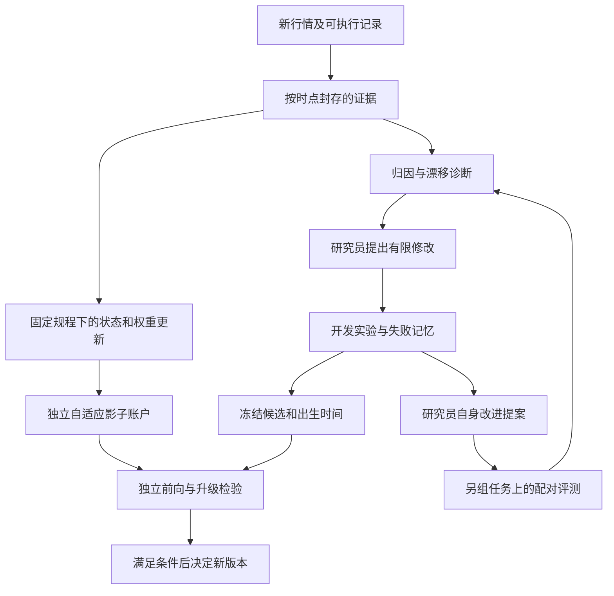

# 策略发布后的自适应与递归自我改进

研究截至 2026 年 11 月 17 日。RSI 在本文指 Recursive Self-Improvement，即递归自我改进。对象是当前 V12-R2 及其研究流程。本报告补充 [11 月 9 日研究](../rsi_20261109/REPORT.md)，重点回答版本发布后如何学习新经验，并结合 [发布后审计](../v12_postrelease_20261116/audit.json) 和 [12 方案迭代](../v12_iteration_20261117/evaluation.json) 修正实施判断。

**结论：值得建设持续学习系统。最有依据的起点是固定更新规则下的有限自适应，以及能记住证据、改进诊断的自动研究流程。现有公开证据尚不足以支持让交易程序无限自改，并预期其长期收益逐代提高。**

发布的对象可以是一套固定学习规程，而不必是一组永远不变的参数。允许状态、估计值和经过约束的权重随新数据更新；改变学习规程、候选空间或升级标准，则作为新的版本重新评价。这样的边界既允许适应，也保留可复核性。

本文区分论文报告、代码实际开放程度和针对本项目的设计建议。没有复现文献全部实验，也没有运行新的策略搜索。所有新增文件位于本研究目录。

## 一 三种改进需要分别证明

| 改进对象 | 发布后的行为 | 正确的比较对象 |
|---|---|---|
| 策略状态 | 根据已实现数据更新波动估计、状态概率或专家权重 | 同一组基础策略的固定配置和固定权重 |
| 策略程序 | AI提出新的准入、退出或配置方案，完成验证后成为新版本 | 原版及同预算的简单搜索 |
| 研究员自身 | 更新假说生成、诊断、经验检索和实验分配方式，改进后的研究员参与后续改进 | 相同任务、模型、信息与总预算下的固定研究员 |

第一层属于在线适应，第二层属于自动研发，第三层更接近严格意义的RSI。三层都可能有价值，名称不能替代结果。基础模型更强、评估次数更多、工具权限扩大，也可能提高成绩；应与研究员自身的改进分开记账。

V12-R2 已有市场状态判断和基于前期波动的急跌阈值，已经包含规则内适应。新增学习模块必须证明增量价值，而不是仅证明参数会变化。

**算力可以增加候选与检查次数，不能按比例增加独立市场证据。** 同一段行情重跑一万次，仍是一段行情。对本项目，最稀缺的是新的市场状态、真实可执行记录，以及策略出现不同决策时的后续结果。

## 二 最直接的交易自我更新证据

### EvolveTrade 支持有限在线更新但不支持每天重写

[EvolveTrade，2026 年 9 月 v1](https://arxiv.org/html/2609.17632v1) 把交易代理的系统提示作为可更新政策，使用过去已实现的交易和工具轨迹，改进下一批决策。基础模型和更新提示保持固定，因此更准确地说是策略流程在线优化。实验涉及15只美股和现金，主要是六个一个月窗口、两种模型、每组3次运行，并补充10bp交易成本。它在部分情景改善，但没有全面战胜固定政策。更新频率消融中，每日更新弱于适度间隔；论文没有验证“5天”对其他市场普遍最优。

对V12的启示是：积累一批反馈，再针对明确的行为缺陷改进。不能把一个月的高Sharpe或更多工具调用，直接解释成长期盈利能力。核读正文未找到可确认的作者完整实现链接；论文附有提示模板。

### EVOQUANT 的受控修改值得借鉴但测试隔离存在疑问

[EVOQUANT，2026 年 11 月 6 日 v4](https://arxiv.org/html/2607.12455v4#S3.SS3) 与本项目非常接近：从既有策略出发，结构化修改信号、风控、仓位和退出，保存拒绝原因与经验。但正文3.2的证据包包含train、validation、test，3.3晋级公式也使用OOS收益和Sharpe。

**据其公开协议推断，这些test/OOS反馈参与了自适应选型，不能作为最终版本的独立确认。** 这不是断言所有结果错误，也不是认定价格特征存在未来函数；问题是统计验证集被用作优化反馈。可以借用修改范围约束和实验账本，不能照搬其测试成绩作为升级证明。

### 经验记忆可以帮助也可以产生负迁移

[Tree-of-Experience 与 FinEvolveBench，2026 年 6 月 v1](https://arxiv.org/html/2606.06960v1) 研究延迟、嘈杂市场反馈下的经验管理。普通记忆方法并非总能胜过无记忆；结构化经验在部分较长预测期更有效，受约束的数值更新优于直接让LLM修改经验权重。其主要指标是预测与未来收益的相关性，未完整包含成交成本、流动性和组合构建，因此属于预测证据。

本项目的经验条目应包含适用市场、决策时点、机制、对照、成本、失效条件和证据链接。“这次红利赚了”不足以形成可复用经验；“某种资格约束在指定条件下排除了可交易防守资产”才构成待检验机制。经验也应有适用范围和撤销记录，不能永久保存成无条件规则。

### 大规模运行不自动带来可交易优势

[两组生产环境交易代理的六个月记录，2026 年 9 月](https://arxiv.org/html/2609.05663v1) 报告：运行约束、仓位和执行机制对行为影响很大，两组系统未显示方向性优势。这里的“生产”需要细分：第一组包含真实资金；第二组大部分成交是实时价格驱动的模拟，缺少真实滑点和资金费。它是运营方自报研究，市场也是加密资产，不能直接外推到A股ETF。

该证据支持优先检查执行与记账机制，并不支持复制其具体止损比例。提示词写得更审慎，不一定改变系统实际成交行为。

## 三 最新RSI研究真正推进了什么

### 从提高验证分数转向管理错误升级

[TRUST，2026 年 11 月 7 日 v1](https://arxiv.org/html/2611.10787v1) 将逐轮接受修改视为在线多重检验，研究如何控制接受劣化更新的比例。它有允许损失幅度、错误预算和验证数据复用修正，实验证据来自问答与编程任务。理论依赖有界分数、信息流与复用偏差上界；论文承认怎样从数据可靠设定相关修正仍未解决。

这支持为研究员升级设置独立验收程序，不能推出“策略每次升级都不退化”。其中的最大回撤是任务分数随改进轮次的回撤，不是投资组合回撤；金融收益、Sharpe与回撤也不能直接替换其任务分数而继承保证。

### 已有更接近真正递归的配对实验

[Flex-RSI，2026 年 11 月 6 日 v1](https://arxiv.org/abs/2611.08946) 允许改进者修改执行者和自身，在固定预算下比较修改运行框架的增量作用，最终使用隐藏测试。论文任务是视觉与机器人；部分任务测试规模很小，随机性也明显。它提供有限的递归改进正面证据，但没有金融实验。

这类方法适合评估“新研究员能否更可靠地定位泄漏、解释失败、减少重复试验”。若它只是更擅长提高已见历史年化，不能据此认定研究能力或未来收益提高。Flex允许修改部分晋级阈值；本文提出冻结最终验收门槛，是针对交易研究的更保守设计，并非原方法照搬。

### 研究编排比论文收益数字更容易迁移

[RD-Agent-Quant v2](https://arxiv.org/html/2505.15155v2) 和 [Microsoft RD-Agent](https://github.com/microsoft/RD-Agent) 提供假说、实现、评估、反馈和记忆的可借鉴结构。其对象主要是因子与模型联合研发；公开论文中的成交时点描述仍需与代码逐项核对。对V12，优先借用编排和实验记忆，保留已有验证过的特征、执行与账户内核。

本次也检查了2026年11月17日可见的main分支：[默认配置](https://raw.githubusercontent.com/microsoft/RD-Agent/main/rdagent/scenarios/qlib/experiment/factor_template/conf_baseline.yaml) 把回测放在test区间，[反馈实现](https://raw.githubusercontent.com/microsoft/RD-Agent/main/rdagent/scenarios/qlib/developer/feedback.py) 将扣费年化、回撤等结果交回LLM并决定是否替换最佳结果。因此，该默认路径需要另设最终隔离确认层；名为test的字段并不自动代表独立测试。这是对当前代码路径的判断，不等同于断言论文当年所有实验使用相同实现。代码未在本地运行，main分支也未锁定为不可变commit。

[AQuA v3](https://arxiv.org/html/2608.12841v3) 展示受限表达式与配置接口的重要性，也披露早期未来信息问题；论文没有实盘验证，部分因子表达式与精确模型配置未公开，测试隔离仍依赖治理。它支持使用有限修改面，不能作为拿来即用的盈利系统。

[ACE-RL，2026年11月12日](https://arxiv.org/abs/2611.16409) 是旧报告之后的新工作：在固定ACE框架内，用经验对后续尝试的实际帮助训练行动、反思和经验整理。其任务不是金融，经验主要在同一任务内传递，没有证明跨任务研究能力持续提升，部分基准和总成本仍有边界。值得借鉴的原则是按未来使用效果评价经验质量，不能因为经验库越来越大就认定系统在进步。

旧报告中的AlphaEvolve、DGM、GEPA等仍可作为程序搜索与研究流程优化参考。本次没有发现足以把它们的代码基准提升直接映射为本项目投资收益的证据。

## 四 直接适应非平稳市场的路线

### 小规模专家组合最接近可执行起点

[Adaptive Robust Online Portfolio Selection](https://arxiv.org/abs/2206.01064) 的期刊版本发表于2025年，方法显式考虑交易成本，并用优势区间减少参数专家之间的频繁切换。可读初稿的新增市场数据截止2021年，部分中国股票实验落后持有基准；不能把发表年份当作测试行情年份。它提供的是成本敏感的更新机制，不是普遍优胜结论。[期刊记录](https://www.sciencedirect.com/science/article/pii/S0377221724006933)

[SAOFTRL，2024](https://palomar.home.ece.ust.hk/papers/2024/ShiPalomar-TSP2024.pdf) 及其基础 [Strongly Adaptive Online Learning](https://proceedings.mlr.press/v37/daniely15.html) 支持同时维护多个学习时间跨度。其理论衡量相对指定比较对象的累计损失差，不保证绝对盈利，也不保证短区间立即识别市场变化。本次通过作者PDF的索引章节核读算法和定理，直接PDF读取超时，未核实完整交易成本实验。

对V12的建议是先使用少量机制不同的专家，并与这些专家的固定等权组合比较。只有自适应权重在扣除新增成本后仍有增量，才能说明更新机制有价值。

### 状态库与旧经验复用值得关注

[ReCAP，KDD 2026](https://arxiv.org/html/2606.00143v1) 用变化检测触发适应，保存既有市场阶段的策略参数差异，并通过门控复用。其历史评估覆盖2020—2025年，包含成本压力测试。但全期存活且数据齐全的成分筛选带来存活偏差疑问；[作者代码](https://github.com/Dumail/ReCAP) 明确为训练规模缩小的最小可运行实现，不能等同完整复现。

可借鉴的是保留旧状态经验、限制新增分支、识别何时复用，而不是把原版不断覆盖掉。神经网络参数向量之间可组合，不意味着两段任意交易代码可以直接相加。

[Meta-Learning the Optimal Mixture of Strategies，2025](https://arxiv.org/html/2505.03659v1) 先筛选有差异的策略再学习组合，提供了策略层表示思路。但正文用旧日频数据集，并非高频执行验证；公开方法代码未核实，部分极高Sharpe口径需要复核。现阶段优先级应低于简单、可复现的专家组合。

### 混合后的真实交易成本必须重新计算

设专家给出的资产权重为b_i，分配器权重为w_i，合成目标是所有w_i b_i之和。真正需要交易的是这个目标相对于账户当前漂移后权重的差额。

不能简单对各专家“已经扣费的收益曲线”加权，就声称得到同一个实际账户：专家权重变化本身会引发交易，专家订单也可能相互抵消。资金限制、最小交易单位、缺报价和成交延迟都会改变合成结果。

专家还应持续维护自己的入场年龄与锁仓状态。进入某个专家时，必须事先规定是跟随其持续影子状态，还是从实际账户重新启动；两者需要分别模拟，不能选择事后更有利的一种。

以上是适配本项目的会计与实验要求，不是相关论文已证明的A股ETF结果。

## 五 持续升级最难的是证据管理

### 新候选不能继承产生它的历史作为新证据

[PROMOTE，2026 年 11 月 2 日](https://arxiv.org/html/2611.03384v1) 专门讨论自适应金融研究：候选诞生时分配检验预算，只用诞生后的净分数累计证据，允许持续观察。其零假设是裁剪后的有界分数在每个计分期的条件均值始终不大于零；在声明条件下，控制整个研究过程错误晋级的概率。检验对象不等同原始平均净收益，也不保证当前或未来盈利。

论文市场回放没有候选晋级；其特定注入信号实验中，15bp情景在成功检出路径中的中位越界时间为2327个交易观察。这个数字不能外推成本项目等待年限，却说明有效性与检测速度存在真实代价。历史有优势后又衰减的策略，也不能靠旧证据永久保有资格。原文区分旧证书与另付预算的当前阶段再验证；任意删除旧观测并重置检验，会改变保证。

### 监测可以持续查看但普通显著性不能无限试

日常检查普通p值，直到碰到一次显著，再宣布升级，会增加错误发现。PBO、DSR、Reality Check各有用途，但不能单独替代不断增加候选、不断查看结果时的完整程序。

[Comparing Sequential Forecasters，2023](https://arxiv.org/abs/2110.00115) 的置信序列思路可以用于持续比较预测器：在相应条件下，为过去平均条件表现提供随时可查看的区间。它不会保证未来市场保持同样关系。实际采用前，应先选清楚评分对象、依赖假设和标签成熟时间，而非直接对任意Sharpe做序贯检测。

可采用固定比较终点，或经过正确设计的序贯方法。两者都应预先登记候选、基准、成本与决策规则。固定终点或单个序贯检验有效，并不自动控制跨候选、跨研究轮次不断追加测试的总体误晋级；还需统一分配相应错误预算，停止或重启不能自动返还预算。发现值得进一步研究的机制，与批准其取代现有账户，是两个不同证据门槛。

### 漂移告警不是替代策略的答案

输入分布变化、收益关系变化和执行故障应分别诊断：

| 现象 | 可以支持的动作 | 尚不能支持的判断 |
|---|---|---|
| 波动、价差、成交量分布改变 | 检查数据与执行；按已登记风控调整 | 某个新排名公式必然更好 |
| 相同信号的后续净收益长期变弱 | 复查条件收益关系与成本 | 单次亏损就证明策略失效 |
| 账本与真实可执行价格明显分离 | 排查时钟、报价和成交假设 | 通过调参消除记录错误 |
| 多个专家输出相同目标 | 记录缺少区分证据 | 强行学出哪个专家更强 |

[ADWIN原论文](https://www.cs.upc.edu/~gavalda/papers/adwin06.pdf) 的分析有输入范围与独立性等条件。将其默认阈值直接用于相关金融收益，不自动得到整个无限监测期的误报保证。漂移检测适合作为诊断触发器；选择替代策略仍需独立证据。

## 六 网上实践中可以采用的部分

| 实践 | 借鉴重点 | 不能直接继承的结论 |
|---|---|---|
| [Qlib OnlineManager](https://qlib.readthedocs.io/en/latest/component/online.html) | 逐期训练、更新、策略状态和预测记录 | 框架支持online不代表任意回测配置都无前视 |
| [RD-Agent](https://github.com/microsoft/RD-Agent) | 研究任务分解、完整轨迹、经验和产物管理 | 不等同适用于V12的成交模型或完整自进化盈利证据 |
| [Hard to Fool](https://arxiv.org/html/2611.06607v1) | 受限JSON提案、验收门槛、拒绝记录、一次确认集使用 | 公开仓库只是参考实现，生产引擎及完整数据未公开 |
| [ReCAP公开实现](https://github.com/Dumail/ReCAP) | 小规模试验状态识别和经验复用 | README已说明并非论文全规模复现 |

Qlib的一些延迟训练优化适合无时间依赖的任务；如果下一轮研究依赖上一轮真实反馈，就必须逐期完成整套流程，不能事后把全部时期一次性训练完再拼接。[官方管理器源码](https://github.com/microsoft/qlib/blob/main/qlib/workflow/online/manager.py)

Hard to Fool报告了一个开发和验证Sharpe接近3、最后确认集降至0.26的候选。工程上值得学习的是它能保存并拒绝这个结果。公开代码的一次使用约束主要落在单个campaign；如果多个campaign重复使用同一个确认窗口，还需要全局数据曝光台账。这是对项目应用的工程推论。

历史 [888个Quantopian策略研究](https://papers.ssrn.com/sol3/papers.cfm?abstract_id=2745220) 也支持警惕回测成绩与后续表现的脱节。其样本外来自部署时间戳后的模拟表现，不能称888个真实资金账户。

对商业系统“持续赚钱”的宣传，本次没有核实到与V12的11只ETF、14:50信号时钟相同口径的长期独立实盘证据。公开代码、演示可运行、历史盈利、前向模拟、真实成交记录应分别登记。

## 七 结合这次复盘应怎样学习

### 当前证据限制了哪些更新

截至11月16日的已审计记录包含30个交易日和5次换仓。V12-R2与三个旧版的持仓和净值完全相同，说明这段数据不能有效区分四个版本。给四个版本加一个“最近谁赚得多就选谁”的分配器，几乎没有可学习差异。[前向审计](../v12_postrelease_20261116/audit.json)

11月17日独立研究的12个方案没有通过既定升级条件。红利熊市准入在9月29日至11月16日收盘回放中从原版-6.02%改善为+4.99%，但在2024—2025年明显落后。这支持提出“条件适用性”的研究问题，尚未证明存在能事前识别该条件的选择器。[研究结果](../v12_iteration_20261117/evaluation.json)、[近期回放](../v12_iteration_20261117/postrelease.json)

必须避免用完整历史给各阶段选赢家，再称为自适应。选择器需要只看当时信息，并把识别延迟、错误切换和成本计入结果。事后能解释某段行情，距离当时能选择对的策略仍有一层待证假设。

### 第一条闭环先改进研究可靠性

建议以独立研究助手起步，持续生成三个产物：逐笔归因、可检验假说、适用范围明确的经验。一个假说至少记录：观测到什么、怀疑哪项机制、什么结果会否定它、准备比较哪些方案、哪些数据已经看过。

新研究员的评价可以包括：能否复现旧结果、找到故意植入的时点错误、识别费用遗漏、拒绝不可靠升级、避免重复实验，以及相同预算下的独立确认结果。不能只以它找到的最高历史年化评分。

例如，本次“抄底减半”的建议被长期结果削弱，理想记忆应保留这一证据和适用区间。下一轮可以据此优先定位最大回撤发生于哪些机制，而不重复自动扩大抄底仓位网格。

### 第二条闭环研究固定规程的有限适应

在独立影子环境内，登记少量有实际行为差异的专家；同时保留原版、静态等权和固定规则切换等对照。权重更新方式、允许读取的历史、遗忘机制、成本约束和新增专家规则都写入候选身份。

可以研究多时间尺度信息和向长期先验收缩的权重更新，但这些属于待验证设计，不是本文确认的最优参数。几次收益差不能让权重直接从零跳到满仓；若采用幅度上限或换手预算，它们也需要事前固定。

若保留当前单一持仓的形式，应把选择专家产生的切换成本和专家内部状态继承定义清楚。若允许多资产组合，则需要对应的份额、现金、成交和费用账户，不能只改一行权重计算。

### 第三条闭环才是跨版本自我改进

研究员可以根据失败轨迹调整自己的诊断与实验方式，但不能同时修改最后的验收标准。应比较：固定研究员、加入证据记忆的研究员、允许有限自改的研究员。在相同基础模型、信息、任务和总查询预算下进行配对，最终用未参与这一代改进的任务确认。

每个新策略有自己的诞生时间与前向证据；每个新研究员也有独立版本及评测任务。跨代错误修正应使依赖旧错误的结论失效，而不是静默覆盖。

## 八 建议发布的是学习规程

建议的实施顺序如下，属于设计提案：

1. **补齐证据。** 保存信号可得的全池报价、特征、资格、排名、备选目标、触发分支、持仓状态、生成与发送时刻及后续可执行价格。缺失时明确标记，不能事后补成当时已知。
2. **先验证学习器。** 在历史中按时间重放完整更新流程；每一步只读当时成熟的反馈和当时已经存在的经验。费用、持仓、锁仓连续继承。
3. **开展前向影子比较。** 从登记后记录全部结果，保留失败候选。观察期长短取决于区分信号、误差与独立事件量，不能把固定60天或100笔当万能证明。
4. **评价是否需要升级。** 必须有经济上值得关注的净改善，同时满足风险、执行和证据条件。达到检验门槛的当期收益不计作升级后的收益。
5. **再评价研究员升级。** 比较研究效率和错误晋级率，避免把更多计算或更强基础模型的收益归给递归机制。

整个自适应流程应至少与三个基准比较：冻结V12-R2、相同专家的静态配置、简单滚动更新。否则无法判断收益来自基础策略、仓位变化，还是学习器。

## 九 事前写明停止与否定条件

| 结果 | 对方案的判断 |
|---|---|
| 自适应权重扣费后不如静态等权 | 尚无证据支持增加学习器复杂度 |
| 改善依赖一个反弹日或随意选定的更新日 | 证据集中，需进一步确认 |
| 去掉未来记忆或按真实标签延迟后优势消失 | 原结果不能支持部署 |
| 研究员只提高开发分数，独立任务没有改善 | 尚未证明研究员进步 |
| 反复重置观察期才出现合格候选 | 需要重建全局试验与曝光记录 |
| 数据或执行缺口足以解释收益差 | 优先修复证据与计量，再谈策略学习 |

短期业绩落后不必自动触发代码重写。预先登记的风险限制可以独立生效；策略替换需要更多证据。反过来，过去检验通过也不能让已经衰减的策略永久免检。

## 十 研究判断

对这个项目，RSI的可行价值首先是让研究更可靠：更快发现错误、减少重复尝试、保存失败条件，并把发布后的真实经验转成可检验假说。有限在线适应有成熟理论与一定金融历史证据，但落地的主要难点是成本、反馈延迟、状态连续性和有效样本量。

最值得建设的系统，应能持续提出改进，也能在证据不足时稳定地维持原版。当前文献支持这一方向的研究投入，尚未证明它能把本项目变成自动持续增厚收益的系统。

详细核读记录见 [在线适应证据](online_evidence.json)、[自我改进论文证据](llm_evidence.json)、[统计与工程实践证据](validation_practice_evidence.json)。报告中的方案是研究设计，尚未部署。
